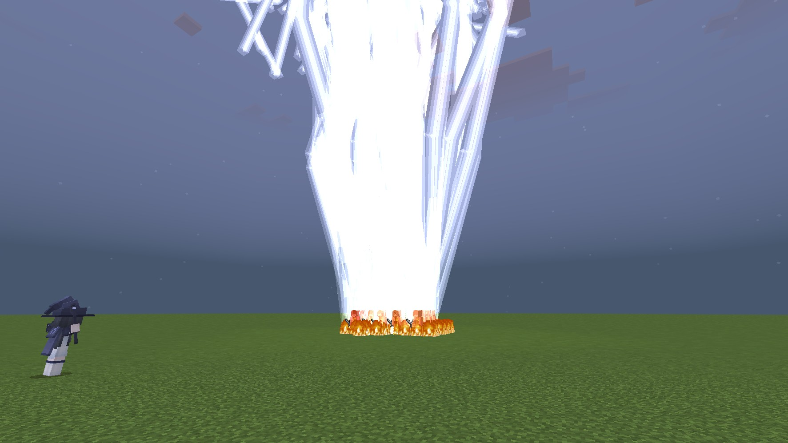

# ⚔️ Fictoria_Impact


A Minecraft Bedrock Edition battlefield combat framework — built around one idea: **take the player off the front line and make them a commander.**

Fictoria_Impact is not just a simple entity AI project. It provides snapshot-based targeting, spatial-hash enemy scanning, unified impulse movement, melee survival prediction, multi-track tactical clock scheduling, pressure-based support aggro, tactical patrol commands, Pokémon-style entity capture, and a full maid companion system with gathering, cooking, farming, guarding, and item handover.

You deploy operators from Fictoria Balls, give standing orders through a tactical UI, and the units fight on their own. The interesting decisions are *who goes where*, *when to spend a recall*, and *which damage type to bring* — not aim or click speed.

The project is designed to keep large-scale entity battles stable. In testing, hundreds of enemy and friendly entities can remain active at the same time without obvious lag. The companion systems are built on the same performance budget as combat: nothing polls the world, everything is event-driven or bucketed across frames.

> The legacy 2022 high-frequency JSON timer architecture has been retired in 2026.  
> The new architecture uses centralized JavaScript clocks, shared enemy snapshots, and ActiveMovers unified drive.

| Item    | Value                                                                   |
| ------- | ----------------------------------------------------------------------- |
| Version | `v0.3.8.5`                                                              |
| Target  | Bedrock Edition, Script API `2.7.0`                                     |
| Content | 206 entity JSONs, 248 animation controllers, 54 scripts / ~30,600 lines |

---

## 📘 Tutorial

[Introduction & Beginner Guide](docs/Images/tutorial.md)

The tutorial covers the first-day flow: taming, the two maid forms, every right-click rule, gathering / cooking / farming / guarding, the tactical command menu, mounts and boats, and the Fictoria Ball.

An in-game version of the same guide ships as the **Field Manual** (`item:field_manual`). New players receive one automatically on first join, together with a loaded Fictoria Ball.

---

## ✨ Recent Updates

### v0.3.8.5 — Maid system

- **Maid companion system**
  - 23 modules / ~13,000 lines under `scripts/dm_entities/dm34/`.
  - Gathering (mining, tree felling, area scan, pillar-up), cooking, farming with bone meal, guarding, shield blocking.
  - Item handover with a real-item + main-hand-proxy model, so tools are never duplicated or eaten.
  - Companion movement: 38-block recall, mount riding with stuck rescue, boat boarding and rowing follow, suffocation escape, water traversal.
  - Sleep schedule driven by component groups only — no JS polling.
  - Field Manual (`item:field_manual`) as an in-game beginner guide.
- **5-frame bucketing for unit updates** (v0.3.8.3)
  - `MAX_UNITS_PER_FRAME = 24`, the unit list is rebuilt every 5 ticks and split into 5 buckets.
  - Single-call peak of `engine.update` dropped from 36 ms to 11 ms (72% → 22% of the tick budget).
  - This buys headroom, not CPU time — the per-tick total is unchanged by design.
- **Velocity commands moved to an in-memory bus** (v0.3.8.1)
  - `dm:cmd_vel_x / y / z` DynamicProperties are gone.
  - `move_command_store.js` keeps a module-level `Map` keyed by entity id: no persistent-property writes, no save dirty flags, ~5× cheaper than `getDynamicProperty`.
  - Saves ~0.49 ms/tick with 60 units on screen.

### Earlier

- **Upgraded to Script API 2.7.0**
  - Core scripts target `@minecraft/server 2.7.0`; UI targets `@minecraft/server-ui 2.0.0`.
- **Retired the Legacy 2022 JSON Timer Architecture**
  - The old 0.1-second looping JSON timer + scoreboard increment pattern is gone from the modern skill pipeline.
  - Skill timing is handled by the JavaScript multi-track Tactical Clock system.
  - Latest entities such as `Kirito.json` use `dm_scores` / `dm_scores_1` clock events.
- **Entity Format Migration (ongoing)**
  - New entities are written on `format_version: 1.21.50`+ (`Kirito.json`, maid entities).
  - Legacy entities are still on `1.8.0` / `1.12.0` and are migrated in batches; see [Technical Notes](#-technical-notes) for the current distribution.
- **Unified ActiveMovers Drive**
  - `main.js` no longer scans dimensions or entity types every tick.
  - It only iterates active units registered in `ActiveMovers`; each receives one impulse per tick.
- **Enemy Snapshot Targeting**
  - Each dimension builds one shared enemy snapshot every 5 ticks.
  - Enemies are indexed into spatial buckets when the count is high.
  - Units no longer perform expensive individual `getEntities()` queries.
- **Melee Movement Engine v2.28**
  - EWMA threat tracking, damage-cycle prediction, block charges and parry-style cancellation.
  - Aggressive / balanced / emergency retreat behavior.
  - Terrain safety: cliff, pit, lava, wall, and step detection; charge-time wall audit.
  - Stuck detection and safe teleport recovery.
- **Support / Bodyguard System**
  - Pressure-based support evaluation, hurt-triggered support calls, monster aggro locks.
  - Silent taunt and target transfer; support handoff when the original monster dies.
- **Fictoria UI and Fictoria Ball**
  - Tactical command UI with follow / random / patrol modes plus a ride toggle.
  - Patrol state persists across world reload.
  - Pokémon-style capture with inventory, enchantment, variant, skin, and tactical state preservation.

---

## 📦 Overview

| Item                   | Value                                                    |
| ---------------------- | -------------------------------------------------------- |
| Version                | `v0.3.8.5`                                               |
| Behavior Pack Entities | 206 entity JSONs / 206 identifiers                       |
| Entity JSON Footprint  | ~2.5 MB in `entities/`                                   |
| Animation Controllers  | 248                                                      |
| Core JS Modules        | 54 files / ~30,600 lines                                 |
| Companion Modules      | 23 files / ~13,000 lines (`dm_entities/dm34/`)           |
| Script API             | `@minecraft/server 2.7.0`                                |
| UI API                 | `@minecraft/server-ui 2.0.0`                             |
| Entity Format          | Mixed: 1.8.0 / 1.12.0 legacy + 1.21.50 / 1.26.50 current |
| License                | MIT                                                      |
| Target Bedrock Version | Bedrock build supporting SAPI 2.7.0                      |

---

## 🎯 Design Positioning

Fictoria_Impact does not make the player stronger. It takes the player **off the front line**.

Vanilla combat progression is about the individual: better sword, better armor, better potion. This project borrows its loop from auto-battlers, tower defense, and tactics games instead:

```text
deploy an operator  →  give a standing order  →  the unit fights on its own
        ↑                                              │
        └──────── recall, reposition, redeploy ─────────┘
```

The player is a commander. The decisions that matter are *who to deploy where*, *when to spend a recall*, and *which damage type to bring* — not aim or click speed. Every operator has to be worth deploying on its own, because once it is on the field the player cannot puppeteer it.

Three systems carry that loop:

| System               | What it contributes                                           |
| -------------------- | ------------------------------------------------------------- |
| Fictoria Ball        | Deployment and recall, with a per-tier recall cooldown        |
| Tactical command UI  | Standing orders: follow / random / patrol, plus a ride toggle |
| Autonomous combat AI | Target selection, positioning, retreat, skill timing          |

---

## 🎖️ Operator Tiers & Skill Economy

Operators are gated by the ball that carries them. The cooldown is the price of repositioning, so it doubles as the tier marker: a cheap unit can be thrown around the battlefield, an elite cannot.

| Ball  | Recall cooldown | Tier          | Design role                                                |
| ----- | --------------- | ------------- | ---------------------------------------------------------- |
| Gold  | 25 s            | Elite         | Compound mechanics, stays above average in more situations |
| Blue  | 15 s            | Elite         | One niche taken to the extreme                             |
| Green | 5 s             | Rank and file | Logistics plus baseline combat — the Maid Union lives here |

The trade-off is deliberate: elites are stronger per deployment but expensive to move, so committing one to the wrong lane costs real tempo. Rank-and-file units are weaker but can be recalled and redeployed constantly, which is what makes logistics work.

### Skill point regeneration

Skill points decide an operator's damage rhythm, and how they are gained matters more than raw numbers. Every operator uses one of three models:

| Model           | Gain                                                       | Strength                                                | Weakness                                        |
| --------------- | ---------------------------------------------------------- | ------------------------------------------------------- | ----------------------------------------------- |
| Auto            | ~1 point per second, combat only                           | Stable and predictable; skills land on a planned window | Fixed rate, no way to accelerate                |
| On hit          | 1 point per landed attack (some skills give 2 per segment) | Attack-heavy units cycle very fast                      | Miss, or get knocked back, and the cycle stalls |
| On damage taken | 1 point per hit absorbed                                   | Enormous uptime in swarms and high-pressure fights      | Needs to be hit; slow and risky at low pressure |

Auto is the generalist, on-hit is the aggressor, on-damage-taken is the defender. Picking a regen model *is* picking the operator's combat tempo.

### Role taxonomy

| Role    | Job                                | Typical regen                            |
| ------- | ---------------------------------- | ---------------------------------------- |
| Damage  | Clear waves, push health bars down | On hit / auto                            |
| Tank    | Hold the front, absorb fire        | On damage taken / auto                   |
| Support | Heal and amplify allies            | Auto (must not depend on enemy behavior) |
| Control | Debuff, summon, disrupt enemy AI   | Mixed                                    |

The four roles are complementary by construction: damage needs a tank to create space, a tank needs support to survive, and control provides answers that raw stats cannot.

---

## 🧠 Architecture

Fictoria_Impact uses a layered battlefield architecture.

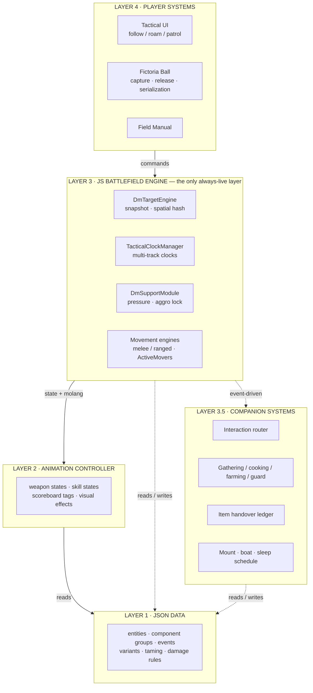


The design philosophy is:

> JSON handles data, events, and animation states.  
> JavaScript handles runtime decisions, performance-critical scanning, scheduling, support logic, and battlefield coordination.  
> They cooperate instead of fighting for control.  
> Combat and companion logic never share a per-tick polling loop; both are fed by the same snapshot and the same frame bucketing.

---

## 🚀 Performance Architecture

Fictoria_Impact is built to remain stable even when many friendly and enemy entities are active at the same time.

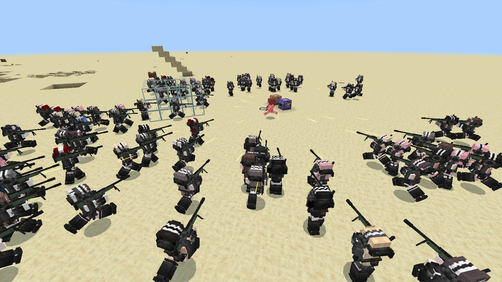

### Enemy Snapshot

Instead of every unit calling:

```js
dimension.getEntities({
    location: unit.location,
    maxDistance: range,
    families: ["monster"]
});
```

the engine builds one shared enemy snapshot per dimension.

Snapshot behavior:

- Scan anchors are created from player positions.
- Anchors are merged into 32-block cells.
- A maximum of 24 anchors are used per dimension.
- Default snapshot radius is 96 blocks.
- Enemies are collected once and shared by all registered DM units.
- If enemy count is low, the snapshot returns a simple array.
- If enemy count is high, enemies are indexed into 24-block spatial buckets.

This dramatically reduces repeated `getEntities()` calls.

---

### Spatial Hash Buckets

When the number of enemies is large, the snapshot indexes them into spatial buckets:

```text
enemy position / 24 → bucket key
```

Units only query nearby buckets instead of scanning all enemies.

---

### Frame Bucketing (5-frame unit slices)

Snapshot sharing removes duplicate scans, but a single `engine.update` call still had to walk every registered unit — and with hundreds of units that call could take longer than a whole tick.

The unit list is therefore rebuilt every 5 ticks and split into 5 slices:

```text
engine.rebuild (every 5 ticks)
  └─ sort registered units, split into 5 buckets of ≤ MAX_UNITS_PER_FRAME (24)

engine.update (every tick)
  └─ process only bucket[currentTick % 5]
```

Each unit is still evaluated once every 5 ticks — the same cadence as the snapshot — but the work is spread across 5 separate ticks.

| Metric                           | Before bucketing      | After bucketing       |
| -------------------------------- | --------------------- | --------------------- |
| `engine.update` per-tick share   | 3.895 ms              | 3.848 ms (unchanged)  |
| `engine.update` single call, avg | 19.33 ms              | 3.79 ms               |
| `engine.update` single call, max | 36 ms (72% of budget) | 11 ms (22% of budget) |

The gain is **peak smoothing, not CPU savings**: the per-tick total is the same, but no single tick can be pushed over the 50 ms budget by the AI layer alone.

---

### Velocity Command Bus

Movement intents used to travel through three DynamicProperties per unit:

```text
dm:cmd_vel_x / dm:cmd_vel_z / dm:cmd_vel_y
```

With 60 units on screen that meant 360 cross-boundary property accesses per tick, 7,200 per second, and every write marked the entity dirty for saving.

`move_command_store.js` replaces them with a module-level `Map` keyed by entity id:

```js
const Commands = new Map();   // entityId -> { x, y, z, tick }
```

- Defaults are `x = 0, z = 0, y = JUMP_IDLE (0.02)`.
- Entries idle for 60 ticks are collected, so a missed remove event cannot leak.
- Zero velocity keeps its entry for one tick — `ActiveMovers` needs it to decide when to brake.
- Reading is a single `Map.get` (~0.27 µs) instead of `getDynamicProperty` (~1.38 µs).

Net effect: ~0.49 ms/tick saved at 60 units, and no save-file churn.

---

### Measured Results

All figures from `/perf:on` → 30 s sampling → `/perf:off`, same probe build, same world, same machine.

| Metric                         | v0.3.5  | v0.3.8.1 | v0.3.8.3+ |
| ------------------------------ | ------- | -------- | --------- |
| mspt                           | 111.20  | 49.65    | 50.50     |
| TPS                            | 8.99    | 20.14    | 19.80     |
| Worst window (ms)              | 111.20  | 51.20    | 51.15     |
| Dropped-tick windows (> 55 ms) | 19 / 19 | 0 / 33   | 0 / 30    |
| Script total (ms/tick)         | 55.30   | 4.77     | 4.56      |
| Script share of budget         | 110.6%  | 9.5%     | 9.1%      |
| `engine.update` (ms/tick)      | 6.576   | 3.895    | 3.848     |
| `main.drive` (ms/tick)         | 48.716  | 0.871    | 0.712     |
| Per-unit-per-pass cost (µs)    | 186     | 164      | 146       |

Two steps did the work:

1. **v0.3.5 → v0.3.8.1: stop the waste.** `main.drive` fell 56× (48.716 → 0.871) after fixing a plural `getEntities({ types })` typo that caused 34× repeated traversal, and moving velocity off DynamicProperties saved another 0.49 ms/tick.
2. **v0.3.8.1 → v0.3.8.3: smooth the peak.** Total script time barely moved; the single-call peak of `engine.update` dropped 36 → 11 ms.

The remaining cost is native-side call overhead. Per-unit-per-pass only fell 21% across three generations, so further JS-level micro-optimization has very little left to take.

---

### ActiveMovers Unified Drive

In the old architecture, `main.js` iterated dimensions and target entity types every tick.

That design had several serious problems:

- The same entity could be queried multiple times per tick.
- The same DynamicProperties could be read multiple times per tick.
- The same entity could receive multiple `applyImpulse()` calls per tick.
- Physics load increased dramatically as entity count grew.

Diagnostic logs once showed:

```text
ticks = 40
active = 1360
```

This meant roughly:

```text
1360 / 40 = 34 effective drives per tick
```

In other words, a single unit could be driven about 34 times per tick.

The new architecture completely removes type scanning from the main drive loop.

```text
AI / movement engine writes velocity commands
  ↓
Units with active velocity are registered into ActiveMovers
  ↓
main.js iterates ActiveMovers only
  ↓
Each active unit receives one impulse per tick
```

Now `main.js` does not query DM entities by type every tick.  
It only processes entities that are currently moving.

---

### Legacy Impulse Compensation

Because the old system accidentally drove entities many times per tick, the new system uses a calibrated multiplier:

```js
const LEGACY_IMPULSE_MULTIPLIER = 34;
```

This preserves the old movement feel while removing the underlying duplicate-drive waste.

The long-term goal is to gradually reduce this multiplier and retune entity speed configurations.

---

### Non-Combat Interception

Units without combat tags are not processed by the movement engine.

Combat gating uses:

```text
dm_has_target
dm_skill_on
```

When a unit leaves combat, its velocity is cleared once instead of being repeatedly reset.

---

### Cache Cleanup

Entity removal listeners clean up cached state such as:

- Damage history
- Forced targets
- Target switching cooldowns
- Active mover entries
- Target sensor tracking
- Patrol records
- Support locks
- Tactical clock entries

This reduces memory leaks during long play sessions.

---

## ⚙️ Core Engine Workflow

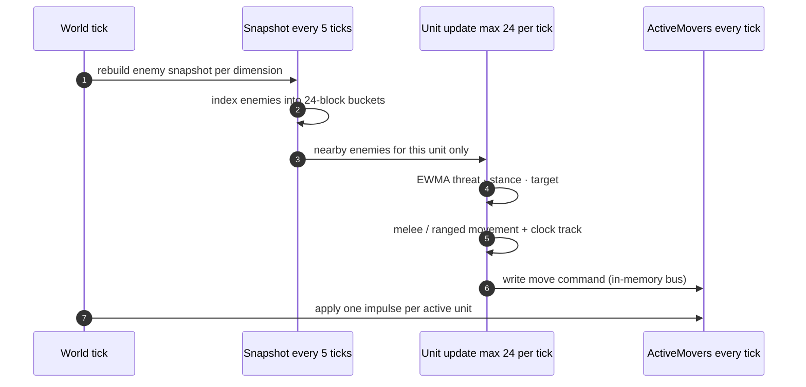

### Every 5 ticks — battlefield AI layer

```text
DmTargetEngine.update()
  ├─ Collect online players per dimension
  ├─ Build one enemy snapshot per dimension
  │    ├─ Use player locations as scan anchors
  │    ├─ Merge anchors into 32-block cells
  │    ├─ Query monster-family entities once per anchor
  │    └─ Index enemies into 24-block spatial buckets
  ├─ Process registered DM units (frame-bucketed, ≤ 24 per tick)
  │    ├─ Resolve config / variant mode
  │    ├─ Update support pressure
  │    ├─ Query nearby enemies from shared snapshot
  │    ├─ Select weighted target
  │    ├─ Handle forced targets and hurt retaliation
  │    ├─ Run melee / ranged movement logic
  │    ├─ Execute TacticalClockManager if clock_time is enabled
  │    └─ Write move_command_store command
  └─ Evaluate dimension-wide pressure support
```

### Every tick — unified impulse drive

```text
main.js driveMaidMuscles()
  ├─ Iterate ActiveMovers only
  ├─ Remove invalid / expired / riding units
  ├─ Read move_command_store (x / z / y per entity)
  ├─ Apply calibrated impulse scale
  └─ applyImpulse() once per active unit
```

### Tactical clock scheduler

```text
TacticalClockManager scheduler
  ├─ Runs every 5 ticks
  ├─ Triggers main track dm_scores every 20 ticks when active
  ├─ Triggers extension tracks dm_scores_1..9 every 20 ticks when enabled
  ├─ Spreads trigger phases by entity ID hash
  └─ Disables missing tracks with circuit breakers
```

### Hurt event pipeline

```text
world.afterEvents.entityHurt
  ├─ Record victim damage history
  ├─ Raise victim pressure
  ├─ Set forced retaliation target
  ├─ Trigger support call if attacker is a monster
  ├─ Notify owner-related followers
  └─ Feed melee pattern prediction
```

---

## 🩸 Damage Model

Two independent defensive layers decide whether an attack is worth making. Neither is a flat "defense" stat — both are built to make the player choose a tool.

### Effective HP (the one-shot line)

Survivability is not health, it is **effective health**:

```text
effective HP = current HP / (1 - damage reduction)
```

A unit with 30 HP and 50% reduction can absorb 60 points of raw damage. This is why a global "+5 max HP" buff is not symmetric: a low-HP, high-reduction operator gains roughly 20% effective health from it, while a high-HP tank gains 7–11%. The same patch note is a different buff depending on who receives it.

### Percent reduction — physical vs magic

Every unit carries two separate percentages. Damage is reduced before it touches health:

| Type               | Covers                         |
| ------------------ | ------------------------------ |
| Physical reduction | Melee, projectiles, explosions |
| Magic reduction    | Magic and skill damage         |

They are fully independent, and they turn team building into a counter-pick decision. Against a target with 68% physical and 30% magic reduction:

```text
1,000 HP ÷ (1 - 0.68) = 3,125 raw physical damage needed
1,000 HP ÷ (1 - 0.30) = 1,429 raw magic damage needed
```

The magic operator is not "the better choice" — it is *the only efficient one* (2.2× faster). Swap the two numbers and physical wins instead.


Implementation: percent reduction is per damage cause, written as `damage_multiplier` in `minecraft:damage_sensor` on the entity itself. A boss with 68% physical reduction literally lists `0.32` for `entity_attack`, `projectile`, `entity_explosion`, `block_explosion`, and `override`, and `0.7` for `magic`. Adding a new damage family means adding a new cause entry, not touching JavaScript.

### Flat reduction — the anti-chip layer

Some enemies subtract a fixed amount from **every damage segment**. This is not about making the enemy unkillable; it is about invalidating a delivery pattern:

| Weapon profile                                              | Result against flat reduction                                      |
| ----------------------------------------------------------- | ------------------------------------------------------------------ |
| High rate of fire, low per-shot damage (rifle, laser sword) | Most of each shot is absorbed                                      |
| Low rate of fire, high per-shot damage (shotgun, sniper)    | Barely affected                                                    |
| Multi-hit combos (2×20 or 3×30)                             | Pays the flat cost **once per segment** — damage falls off a cliff |

So the counter to a flat-reduction enemy is not "more DPS", it is *switching weapon class*, or *not bringing a multi-hit operator*. Percent reduction decides which characters you bring; flat reduction decides which weapon you point at it.

> Flat reduction is content-level, not a global system: it is configured per enemy, so it can be tuned without touching shared code.

---

## 🗡️ Melee Movement Engine

`movement_melee.js` is not a simple charge script.  
It is a melee survival and positioning engine that decides how an entity should fight based on threat pressure, damage history, health trend, terrain safety, and stuck risk.

The current version is the **v2.28 Stable Terrain-Safe Engine** (charge wall-audit revision).

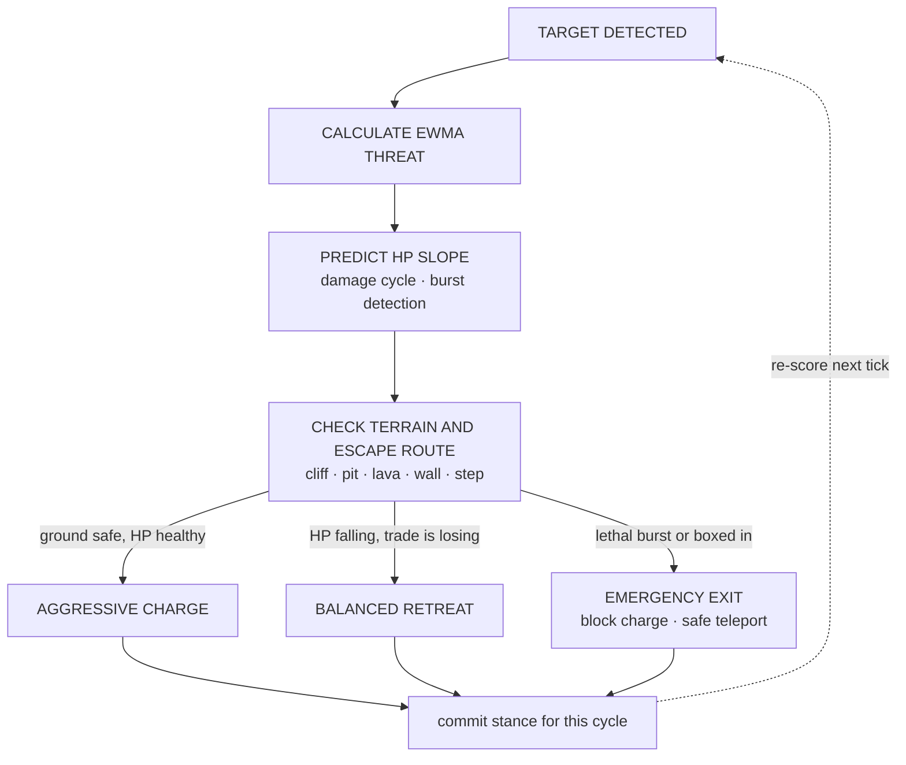

The stance is not scripted per entity: the same engine decides for a maid, a boss, and a Kirito template, and the stance can flip mid-fight.

---

### Threat Perception

The melee engine does not blindly trust the nearest entity.

It resolves targets using multiple fallback layers:

```text
1. Highest EWMA threat score
2. Recent hurt source
3. Radar-provided closest threat
4. Vanilla unit.target fallback
```

This prevents the entity from being distracted by irrelevant attackers.

For projectile-based melee AOE systems, the engine also performs attacker attribution:

```text
projectile → owner component → entity owner → nearest monster fallback
```

This prevents fake projectile damage from polluting the real melee threat model.

---

### EWMA Threat Tracking

Each attacker contributes to a threat score.

The score decays over time, so recent damage matters more than old damage.

This allows the melee unit to focus on the enemy that is actually applying pressure.

---

### Damage Truth Verification

The engine does not trust every HP drop blindly.

It uses a real-hurt ledger and a buffer-layer fence:

- HP drops must be corroborated by recent hurt events.
- Absorption changes are separated from real damage.
- Health Boost changes are separated from real damage.
- Buff transitions can activate a short observation fence.
- Uncorroborated HP drops are discarded.

This prevents fake HP changes from corrupting the survival model.

---

### Survival Prediction

The melee engine continuously predicts whether the entity can survive the current fight.

It considers:

- Current HP percentage.
- Recent burst damage.
- Observed net HP slope.
- Regeneration effects.
- Absorption shields.
- Damage cycle interval.
- Cycle DPS.
- Estimated next damage peak.
- Single-hit lethal risk.

If the predicted survival pressure is too high, the engine switches from aggressive mode to balanced retreat mode.

---

### Unified Cycle Engine

The engine analyzes repeated damage peaks and builds a unified damage-cycle model.

It estimates:

```text
cycle seconds
cycle DPS
time to next damage peak
wave lethality
maximum single-hit pressure
```

This allows the entity to retreat before a dangerous damage wave arrives, instead of reacting only after HP has already dropped.

---

### Combat Strategies

The melee engine currently uses several behavior layers.

#### Aggressive Mode

Aggressive mode focuses on closing distance and applying pressure.

It supports:

- Charge initiation.
- Charge distance tracking.
- Charge termination near melee range.
- Charge AOE damage on impact.
- Vertical correction for height differences.

#### Balanced Mode

Balanced mode is a defensive retreat and orbit state.

It has two phases:

```text
Phase 1:
  Retreat with slight tangential drift.

Phase 2:
  Orbit around the target while maintaining spacing.
```

Balanced mode is used when:

- HP is low.
- Burst damage is detected.
- The damage cycle becomes lethal.
- Block retreat is active.
- Net HP slope predicts imminent death.

#### Emergency Retreat

If HP falls below a critical threshold, the engine enters emergency retreat.

Emergency retreat increases backward movement power and may use stronger jump impulses.

#### Panic Retreat

If the entity is already in balanced mode and suddenly takes heavy damage, it can trigger panic retreat.

---

### Block System

The melee engine supports block charges.

When entering balanced mode, the entity may receive a limited number of block charges.

If an incoming hit is large enough, the engine can:

- Cancel the damage.
- Reduce remaining block charges.
- Clear velocity.
- Force balanced retreat.
- Trigger the `dm:block_parry` event.

This creates a parry-like defensive behavior.

Block charges can recharge when the entity recovers enough HP.

---

### Terrain Safety

Balanced-mode movement now includes terrain safety deflection.

Before moving, the engine probes the terrain ahead.

Possible probe results:

```text
safe   — walk normally
step   — one-block step, jump over it
wall   — two-block wall, redirect movement
pit    — one-block hole, avoid it
cliff  — deep fall, avoid it
lava   — lava hazard, avoid it
```

If the current movement direction is dangerous, the engine deflects movement along a safe tangential direction.

This allows retreat to continue without walking off cliffs, into pits, or into lava.

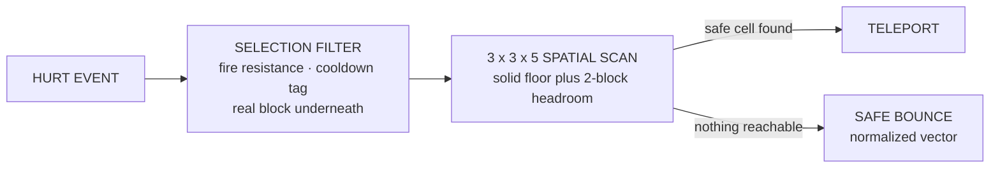

The same two-step shape — event, filtered spatial probe, then teleport or deflect — is used for both the melee probe and the companion hazard escape (`suffocation_escape.js`).

Aggressive charge behavior intentionally keeps a more raw charge feel and does not apply the same terrain deflection.

---

### Stuck Detection and Recovery

The melee engine includes multiple recovery systems.

It can detect:

- Wall blocking.
- Low-ceiling blocking.
- Being stuck inside a wall.
- Lack of position progress.
- Liquid floating.
- Airborne movement limitations.

When stuck, it may:

- Reverse strafe direction.
- Jump.
- Clear velocity.
- Search for a safe teleport spot.
- Teleport with block checking.

This greatly improves reliability in complex terrain.

---

## 🏹 Ranged Movement Engine

`movement_ranged.js` is the counterpart to the melee engine: instead of closing distance safely, it maintains it.

### Dynamic kiting

Retreat speed is not a constant. It is computed against the current threat:

```js
const SPEED_MULTIPLIER = 1.3;   // strafe speed = enemy speed × 1.3
```

Always slightly faster than the thing chasing it. If an enemy is faster anyway and closes the gap, the engine spends a super backdash to reset the distance instead of letting the operator get pinned.

### Distance policy

| Enemy distance          | Behavior                                                   |
| ----------------------- | ---------------------------------------------------------- |
| Close                   | Straight-line retreat, highest priority on opening the gap |
| Far                     | Orbit the target at `strafeRange`, firing while circling   |
| Too close after retreat | Super backdash, then resume                                |

### Terrain and speed linkage

- Walls are never walked through: the engine deflects direction and looks for a passable line.
- Pits are jumped rather than walked into.
- Kiting speed responds to the operator's own speed effects — slow the operator and its retreat slows with it, so debuffs matter for ranged units too.

Ranged units also use `clock_time` for skill gating, so a kiting operator does not accidentally spend a skill window it was saving.

---

## ⏱️ Tactical Clock System

`tactical_clock_manager.js` provides a deterministic multi-track clock scheduler.

It replaces the legacy JSON timer architecture that had been used since 2022.

In 2026, this old architecture has finally been retired.

---

### The Legacy 2022 Timer Architecture

The old skill timing system was very primitive.

It relied on a high-frequency JSON timer:

```text
JSON timer loops every 0.1 seconds
  └─ add 1 to a scoreboard objective
```

This design had several problems:

- It ran extremely frequently.
- It depended heavily on scoreboard increments.
- It was difficult to coordinate with combat states.
- It was mutually exclusive with the silent / idle timer in a crude way.
- It was hard to scale across many entities.
- It was hard to disable cleanly.
- It produced a lot of unnecessary event noise.

It worked for the early project, but it was not suitable for a large battlefield framework.

---

### The New Multi-Track Tactical Clock

The new system is implemented in JavaScript.

Instead of every entity running its own high-frequency JSON timer, the clock manager centrally schedules active tracks.

### Clock Tracks

| Track            | Event                          | Controlled By                                            | Purpose                                        |
| ---------------- | ------------------------------ | -------------------------------------------------------- | ---------------------------------------------- |
| Main track       | `dm_scores`                    | Combat tags                                              | Periodic combat/skill progression              |
| Extension tracks | `dm_scores_1` to `dm_scores_9` | Entity properties `dm:clock_time_1` to `dm:clock_time_9` | Skill duration, phase control, state switching |


The scheduler runs every 5 ticks.

Active tracks fire every 20 ticks, which equals one second.

```text
Scheduler step: 5 ticks
Track trigger interval: 20 ticks
Phase count: 4
```

---

### Phase Offset Load Spreading

To prevent many entities from firing clock events on the same tick, each entity receives a phase offset based on its entity ID hash.

```text
phase = hash(entity.id) % 4
```

This spreads clock triggers across different scheduler phases.

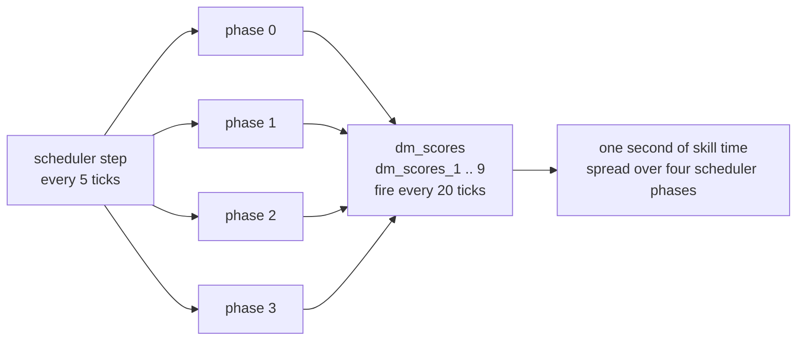

Four entities with different IDs never land on the same scheduler tick, so a hundred units cost the same per-tick spike as one.

---

### Session Safety

The clock system uses a world session ID.

When the world reloads or `/reload` is executed, the session changes.

This allows the clock system to:

- Reset stale track state.
- Re-detect track mode.
- Clear old circuit-breaker flags.
- Avoid old-session cache pollution.

---

### Missing Event Circuit Breaker

If an entity does not have a required event, such as:

```text
dm_scores
dm_scores_1
dm_scores_2
...
```

the clock manager disables that track for the current session instead of spamming errors.

---

### Track Mode Detection

The clock system automatically detects whether an entity is single-track or multi-track.

```text
single-track entity:
  only main dm_scores track

multi-track entity:
  dm_scores + dm_scores_1..9 controlled by entity properties
```

Multi-track entities can turn extension tracks on or off during gameplay.

For example:

```json
"set_property": {
    "dm:clock_time_1": "on"
}
```

or:

```json
"set_property": {
    "dm:clock_time_1": "off"
}
```

The clock manager reads these states every execution pass, so runtime switching works correctly.

---

### Combat Gate

The main clock track is gated by combat tags.

For single-track entities:

```text
main track active = dm_has_target
```

For multi-track entities:

```text
main track active = dm_has_target AND NOT dm_skill_on
```

This prevents the main clock from continuing to charge a skill while the entity is already inside a special skill state.

Extension tracks are controlled by their own `dm:clock_time_N` properties.

---

### Example: Kirito SSS Flow

`Kirito.json` is one of the latest templates using the new clock system.

It declares:

```json
"properties": {
    "dm:clock_time_1": {
        "type": "enum",
        "values": ["def", "on", "off"],
        "default": "def",
        "client_sync": true
    }
}
```

Its flow is:

```text
attack event
  └─ add dm_has_target

main clock track fires dm_scores every second while in combat
  └─ dm_skill_timer increases

dm_skill_timer reaches threshold
  └─ trigger sss event

sss event:
  ├─ remove dm_has_target
  ├─ add dm_skill_on
  └─ set dm:clock_time_1 = on

extension clock track fires dm_scores_1 while dm:clock_time_1 is on
  └─ dm_skill_timer_1 increases

dm_skill_timer_1 reaches threshold
  └─ trigger back event

back event:
  ├─ remove dm_skill_on
  └─ set dm:clock_time_1 = off
```

This replaces the old high-frequency JSON timer pattern with a controlled, session-aware, multi-track JavaScript clock.

> Note: some one-shot delays may still use JSON timers where appropriate.  
> The tactical clock mainly replaces periodic skill/state scheduling, not every single delay in the project.

---

## 🛡️ Support / Bodyguard System

`dm_support_system.js` provides a pressure-based support system for friendly DM units.

Instead of every unit fighting independently, nearby low-pressure units can respond to high-pressure allies, pull monster aggro, and transfer support targets when enemies die.

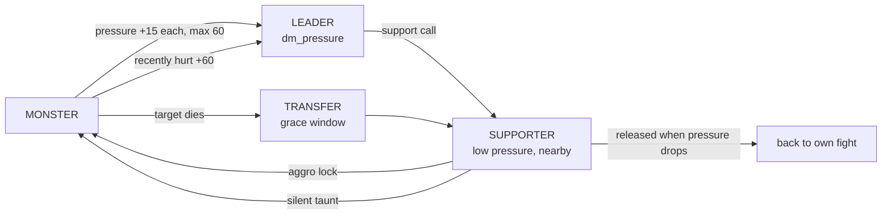

---

### Pressure Model

Each support-enabled unit has a pressure value stored in:

```text
dm_pressure
```

Pressure is affected by:

| Source                                 | Effect                    |
| -------------------------------------- | ------------------------- |
| Nearby monsters inside pressure radius | +15 per monster, up to 60 |
| Recently hurt                          | +60                       |
| Recently dealt damage                  | +20                       |
| Final value                            | Clamped to 0–100          |

Generally:

- High-pressure units can call for support.
- Low-pressure units can respond as support.
- Recently hurt units bypass pressure update throttling for immediate response.

---

### Support Triggers

There are two main trigger paths.

#### 1. Hurt-triggered support

When a DM unit is hurt by a monster:

```text
victim pressure spikes
  └─ system searches nearby eligible supporters
       └─ one low-pressure supporter takes the aggro lock
            └─ supporter performs silent taunt
                 └─ monster target is transferred to supporter
```

#### 2. Pressure-based cooperative support

During the main engine update:

```text
high-pressure caller + low-pressure responder
  └─ nearest eligible responder is selected
       └─ aggro lock is registered
            └─ silent taunt transfers monster target
```

---

### Aggro Lock

The system uses a monster aggro lock:

```text
monsterId -> supporterId
```

This prevents multiple support units from repeatedly grabbing the same monster and causing unstable AI behavior.

A reverse index is also maintained:

```text
supporterId -> Set<monsterId>
```

This allows fast cleanup when a supporter dies, is removed, or finishes support.

---

### Silent Taunt

Support units create aggro using a fake 0.5 damage hit:

```text
monster damages supporter for 0.5
```

The actual hurt event is then canceled to avoid:

- red damage flash,
- knockback,
- unnecessary combat noise.

Then the monster target is forced to the supporter.

---

### Target Death Transfer

If the supported monster dies before the support ends, the system tries to transfer support to the nearest unlocked monster within the pressure radius.

If transfer succeeds:

```text
support continues with the new monster
```

If transfer fails:

```text
support lock is released
```

A short grace period prevents the support lock from being released immediately after a successful transfer.

---

### Support Configuration

Support behavior is configured per entity mode in `DmTargetRegistry`:

```js
supportEnabled: true,
pressureRadius: 8,
supportCooldown: 80
```

| Field             | Description                                           |
| ----------------- | ----------------------------------------------------- |
| `supportEnabled`  | Enables support participation                         |
| `pressureRadius`  | Radius used for pressure counting and target transfer |
| `supportCooldown` | Cooldown before the unit can support again            |

---

## 🎮 Fictoria UI — Tactical Command System

`fictoria_ui.js` provides a player-facing tactical command system for friendly units.

Players can sneak + attack a friendly unit to open an ActionForm menu.

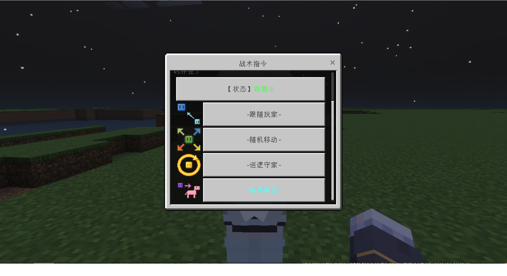

The panel shows the current state at the top and the mode entries below it.

### Supported Modes

| Mode            | Description                                                     |
| --------------- | --------------------------------------------------------------- |
| Follow Player   | The unit follows its owner                                      |
| Random Movement | The unit roams freely                                           |
| Patrol Guard    | The unit guards a home area and is teleported back if it leaves |
| Ride            | Toggle for mount / boat following                               |

### Patrol Persistence

Patrol state is stored using DynamicProperties and a persistent tag:

```text
fictoria_patrol
```

After world reload, patrol units are automatically restored.

The system supports both:

- Tag-based restoration.
- Legacy DynamicProperty-based restoration.

### Home Guard

When a unit is assigned to patrol mode, its current position is saved as the patrol home.

If the unit leaves the home area, it is teleported back.

Default home radius:

```text
32 blocks
```

### Item-Gated Units

Some units, such as maid-type entities, use inventory-based follow gating.

For these units, the UI may add or remove a command item from the unit inventory to switch follow state.

The system also verifies whether the expected follow / sit event actually fired, and reports success or failure to the player.

### Fictoria Ball Integration

Fictoria UI state is preserved when a unit is captured by a Fictoria Ball.

After release, the tactical UI state is restored through the global bridge:

```js
globalThis.FICTORIA_UI_SYNC.resumeState(unit)
```

---

## 🔮 Fictoria Ball — Entity Capture System

`fictoria_ball.js` adds a Pokémon-style capture and release system for friendly units.

### Capture Data

When a unit is captured, the ball stores:

- Current HP.
- Max HP.
- Variant.
- Skin ID.
- Name.
- Entity type.
- Owner ID.
- Owner name.
- Inventory data.
- Tactical UI state.

### Inventory Serialization

The system serializes:

- Item type.
- Item count.
- Durability.
- Custom name.
- Enchantments.

Enchantment restoration is compatible with both:

```text
minecraft:enchantable
minecraft:stored_enchantments
```

### Special Item Rules

Some items are too complex or unsafe to serialize.

| Item Type            | Behavior                |
| -------------------- | ----------------------- |
| Empty map            | Saved                   |
| Filled map           | Dropped                 |
| Shulker box          | Dropped                 |
| Bundle               | Dropped                 |
| Writable book        | Dropped                 |
| Written book         | Dropped                 |
| Enchanted book       | Saved with enchantments |
| Filled Fictoria Ball | Dropped, never stored   |

### Anti-Nesting Protection

Filled Fictoria Balls cannot be captured into another Fictoria Ball.

If a unit is carrying a filled ball, the filled ball is dropped instead of being stored.

This prevents recursive ball nesting.

### Placement Safety

Before releasing a unit, the system checks whether the target position is safe.

It avoids:

- Solid-block suffocation.
- Lava placement.
- Invalid adjacent spaces.

### Placement Cooldown

The cooldown starts when the unit is **captured**, not when it is released — it is the price of pulling a unit off the field, and it gates how soon it can come back.

```text
recall  →  cooldown starts  →  ball shows as a CD item  →  hot-swap to ready form
```


While cooling down, the filled ball uses a cooldown item form; when it expires the item is hot-swapped into the ready form. The durations are what separate the tiers (see [Operator Tiers](#-operator-tiers--skill-economy)).

### Ball Types

| Ball                | Recall cooldown | Tier                                         |
| ------------------- | --------------- | -------------------------------------------- |
| Gold Fictoria Ball  | 25 s            | Elite: compound mechanics                    |
| Blue Fictoria Ball  | 15 s            | Elite: single-niche specialist               |
| Green Fictoria Ball | 5 s             | Rank and file: logistics and baseline combat |

---

## 🧹 Maid System (Companion Layer)

The maid (`player:dm34` / `player:dm34_1`) is the first full companion built on the engine, and the reference implementation for everything that will later be shared with every friendly unit.

In the tier system she sits in the **green-ball rank and file** — the Maid Union. The two forms are convertible job classes rather than tiers: logistics (Standard) and combat (Armory), promoted or demoted at will with War Cross / Gentle Cross. That is what makes the green tier viable: a 5-second recall means the player can actually afford to swap her role mid-battle.

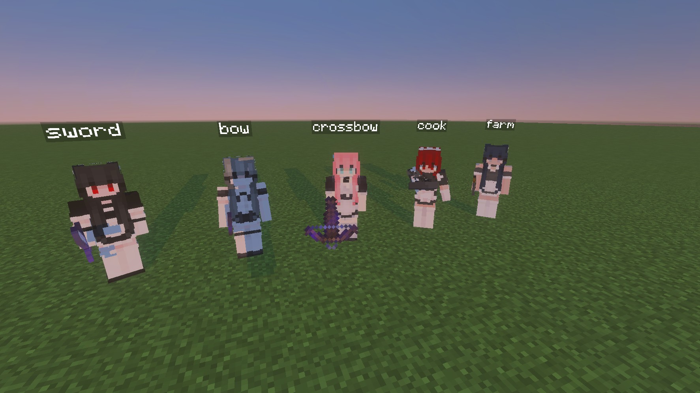

Full player-facing instructions live in the [tutorial](docs/Images/tutorial.md) and in the in-game Field Manual. This section is the architecture summary.

### Two forms

| Form          | Entity          | Role                                                                                 |
| ------------- | --------------- | ------------------------------------------------------------------------------------ |
| Standard Maid | `player:dm34`   | Melee / bow / crossbow combat, plus cooking, farming, mining, tree felling, guarding |
| Armory Maid   | `player:dm34_1` | Firearm specialist: M4A1 / Mossberg / AWP / Glock / Photon Sword                     |

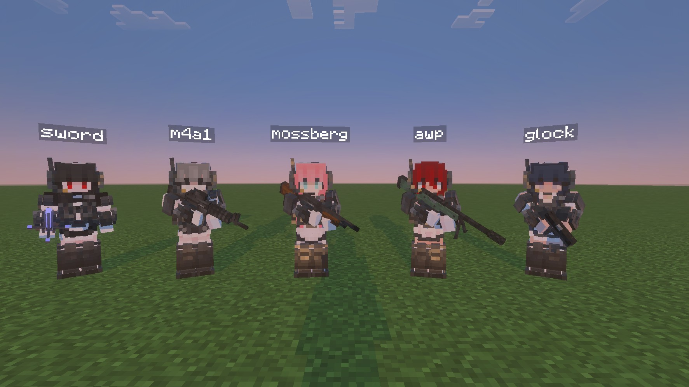

Promotion and demotion use `item:dm34_war_maid` (War Cross) and `item:dm34_gentle_maid` (Gentle Cross). Both directions drop the current equipment at her feet, so the player never loses gear to a form change.

### Interaction router

`interact_router.js` owns a single ordered dispatch table. The first matching rule wins, and anything that matches nothing falls through to vanilla container behavior — JavaScript never hijacks an interaction it did not recognize.

```text
armor → shield → raw food → hoe → weapon → Maid Command
      → saddle / mount → cooking take-out → leave-state → rule table
```

Gathering states invert the rule: while she is mining, chopping, or farming, the router deliberately ignores her own trade tools so a stray right-click cannot restart the mode.

### Item handover

Tools are never moved by simply writing item stacks around. `record_store.js` keeps a ledger of real items; the main hand holds a proxy while she works.

```text
give item      → write record → set main hand
take item back → give real item → clear main hand → clear record
```

If a record is missing on load, the orphan path hands the real item back instead of silently deleting it. The rule is **keep, never eat**: if the real item cannot be read, nothing is cleared.

### Gathering pipeline

`gather.js` is the largest module in the project (~4,700 lines) and runs three cooperating layers:

| Layer          | Range     | Technique                                                        |
| -------------- | --------- | ---------------------------------------------------------------- |
| Mid-range scan | 48 blocks | 16³ sub-chunk sweep, one sub-chunk per tick, full sweep in ~10 s |
| Near-range eye | 24 blocks | direct block checks                                              |
| Far target     | 82 blocks | pathfinding only, `must_reach: false`                            |

Supporting systems: pillar-up to reach high targets, reach repair when pathfinding stalls, a crack overlay entity spawned once per target, and trunk collection for tree felling — the trunk is tracked as a coordinate list and only grows upward and sideways, never downward into foundations.

### Companion movement

| Feature                  | Behavior                                                                                                                                     |
| ------------------------ | -------------------------------------------------------------------------------------------------------------------------------------------- |
| Follow / random / patrol | Tactical UI modes; patrol home is persisted and restored after reload                                                                        |
| Recall                   | Teleported back when farther than 38 blocks in follow mode                                                                                   |
| Leash check              | Gathering states are intentionally non-following; beyond 32 blocks she is recalled, the crack overlay is withdrawn, and drops are snapped up |
| Mount                    | Board a horse / donkey / mule / pig / llama within 16 blocks, then drive it along the follow path                                            |
| Mount rescue             | If the mount has not moved for ~1.5 s with a step ahead, or the player is 40+ blocks away, mount and maid are teleported together            |
| Boat                     | Boards the player's boat, then rows to follow; wooden boats, rafts, and chest boats                                                          |
| Escape                   | Suffocation escape, water traversal, and stuck recovery                                                                                      |

While riding, the main impulse drive is suppressed (`maid:ride_player`) so the engine cannot fight the vehicle.

### Rest and light

- Sleep is pure JSON: a `sleep` component group plus a `sleep_time` scheduler group that is added when idle and removed when working. Group add/remove restarts the scheduler, which is what makes her sleep the same night instead of the next one.
- A torch anywhere in her inventory enables her dynamic light source.
- A saddle in the saddle slot makes her rideable; holding a saddle and right-clicking carries her.

---

## 👹 Enemy Faction

The hostile side is not a pile of individually hostile mobs. It is an organised force with the same kind of division of labour the allied side has.

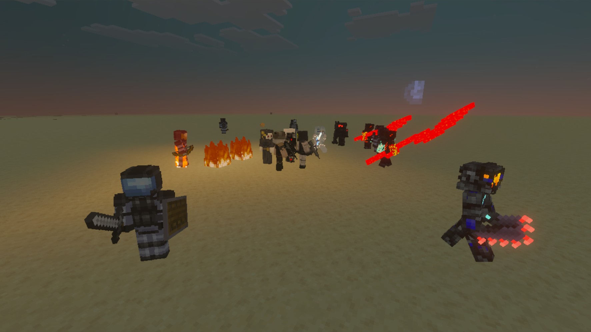

| Enemy role          | Behavior                                                                                            |
| ------------------- | --------------------------------------------------------------------------------------------------- |
| Scout / broadcaster | Finds the player, then **calls reinforcements** — a contact can snowball into a multi-angle assault |
| Ranged suppression  | Keeps distance and applies continuous fire on players and operators                                 |
| Melee raider        | Pushes into the formation to break the line                                                         |
| Air unit            | Ignores ground obstacles and attacks from above                                                     |

Because these roles cooperate, the pressure is multi-front: a broadcast pulls ranged and melee units in from different directions at the same time. A defence that only answers one direction collapses.

Elite and boss units sit on top of that. Many run the same skill-clock architecture as allies — periodic skills, health-gated phases, and percent-reduction profiles that force a specific damage type (see [Damage Model](#-damage-model)).

---

## 🗡️ Kirito — Latest Elite Entity Template

`Kirito.json` is one of the latest elite entity templates and demonstrates the modern Fictoria_Impact entity architecture.

### Key Features

- Uses `format_version: 1.21.50`.
- Uses `minecraft:behavior.melee_box_attack`.
- Uses the new multi-track tactical clock system.
- Uses `dm:clock_time_1` as an extension clock track control property.
- Uses `dm_scores` for main skill charging.
- Uses `dm_scores_1` for skill duration termination.
- Uses combat tags:
  - `dm_has_target`
  - `dm_skill_on`
- Integrates with the support system through the shared registry config.
- Demonstrates the replacement of the legacy 2022 JSON timer architecture.

Kirito is a good reference for future elite entities that combine rich JSON state machines with the JavaScript battlefield engine.

---

## 🧬 Entity System

### Type A: JSON-Heavy Elite Units

These entities use rich JSON component groups, events, sensors, and animation controllers.

The JavaScript engine still assists them with:

- tactical clock scheduling,
- support pressure,
- hurt history,
- forced retaliation,
- movement assistance,
- stuck safety,
- friendly-fire protection.

Examples:

| Entity     | Role                 | Regen           | Specialty                                                                       |
| ---------- | -------------------- | --------------- | ------------------------------------------------------------------------------- |
| `dm0`      | Damage (hybrid)      | Auto            | Sword / bow / ultimate skills                                                   |
| `dm41`     | Damage (burst)       | On hit          | High single-hit damage                                                          |
| `dm60`     | Damage (AoE)         | Auto            | Scoreboard-driven rage and area pressure                                        |
| `dm61`     | Damage (artillery)   | Auto            | Long-range pressure and summon behavior                                         |
| `dm63`     | Tank / control       | On damage taken | Reflect shield                                                                  |
| `dm52`     | Support              | Auto            | Healing and summon support                                                      |
| `dm25`     | Tank / damage        | On damage taken | Line-breaking AoE melee                                                         |
| `dm62`     | Damage (gambler)     | Auto            | HP-scaling damage and speed — see [case studies](#-design-case-studies)         |
| `boss1`    | Boss                 | —               | Mixed melee / ranged boss mechanics — see [case studies](#-design-case-studies) |
| `fire_boy` | Super boss           | —               | Fire-themed AoE pressure                                                        |
| `kirito`   | Damage (melee elite) | Auto            | Clock-driven SSS, `melee_box_attack`, modern template                           |
|            |                      |                 |                                                                                 |

---

### Type B: Engine-Driven Units

These entities receive most combat behavior from the JavaScript engine and the `DmTargetRegistry` configuration table.

| Entity   | Modes                                                                             | Weapons / Tools                                |
| -------- | --------------------------------------------------------------------------------- | ---------------------------------------------- |
| `dm34_1` | Armory Maid, 5 combat modes                                                       | M4A1 / Mossberg / AWP / Photon Sword / Glock   |
| `dm34`   | Standard Maid: 3 combat modes + cooking / farming / mining / tree felling / guard | Iron sword / bow / crossbow, hoe, pickaxe, axe |

Example configuration:

```js
"player:dm48": {
    normalRange: 40,
    alertRange: 48,
    focus: 4.0,
    speed: 12,
    combatType: "ranged",
    strafeRange: 14,
    strafeSpeed: 0.4,
    clock_time: true,
    supportEnabled: true
}
```

Important config fields:

| Field            | Description                                          |
| ---------------- | ---------------------------------------------------- |
| `normalRange`    | Normal target search radius                          |
| `alertRange`     | Expanded alert radius for forced targets             |
| `focus`          | Weight multiplier for keeping the current target     |
| `speed`          | Affects movement responsiveness and target switching |
| `combatType`     | `"melee"` or `"ranged"`                              |
| `strafeRange`    | Preferred ranged spacing                             |
| `strafeSpeed`    | Lateral movement speed                               |
| `clock_time`     | Enables tactical clock behavior                      |
| `supportEnabled` | Enables support-system pressure evaluation           |

Some entities support variant-based modes:

```js
"player:dm34_1": {
    modes: {
        1: { ... },
        2: { ... },
        3: { ... },
        4: { ... },
        5: { ... }
    }
}
```

---

## 📐 Design Case Studies

Five units that show how the systems above are meant to be combined. Stats are the intended design values, not balance promises.

### Boss1 — 哈罗德 (Harold): the line-breaker

- 1,000 HP, 68% physical / 30% magic reduction, 37-block detection that ignores blocks.
- Two weapon modes: melee inside 7 blocks (0.5 s interval, 20 damage), ranged burst outside 7 (0.8 s interval, 24-block range, 20 damage, pierces and burns).
- Passive: being hit triggers a 10-block knockback (14 damage). **While the knockback is running it cannot attack at all.**

The passive is the whole fight. Sustained high-frequency pressure keeps interrupting its attack cycle, so a fast attacker can lock it down — which is exactly the wrong thing to do with a slow, heavy hitter. Counter-play is magic damage (2.2× efficient), spread positioning (the ranged mode pierces), and a fast attack rhythm to keep the roar firing.


### Military Engineer — the saboteur

- 35 HP, 15% / 15% reduction, deals no damage itself.
- Day: disguises as a friendly NPC and follows the player, unidentifiable by normal means.
- Night: hunts the player's base — digs walls, breaks redstone, steals from chests. Sabotage windows every 15 s, or every 5 s during the ultimate.
- Summons two mech dogs that carry all of its combat; the dogs **switch between melee and rifle mode depending on how they are being attacked**. Its ultimate spawns drones that heal nearby enemies and broadcast the player's position.
- Below 50% HP it stealths with particles and flees; getting hit 5 times broadcasts the player's position.

Killing it is a chase, not a duel: you have to pursue, break the stealth, and cut through dogs and drones before it escapes. Killing the engineer removes every summon.

### Derica — the tempo trap

- Attack-regen only (1 point per hit), so melee is the fast cycle and ranged is the safe-but-slow one. The 7-block threshold forces the choice.
- Mixed damage uses a **take-the-highest** rule: physical 33 and magic 20 on the same hit applies 33, never 53. Against a physical-immune target the magic value takes over.
- Ultimate: 10 seconds of invincibility, auto-locking the nearest target, chaining teleports after each kill.
- Outside the ultimate, holding one target for 10 seconds grants every nearby ally (including herself) 10 skill points plus a 5-second heal / absorption / 2.6× damage buff. Switching targets resets the timer.

The design trick: "versatility" is converted into a risk-managed dilemma, and a precision damage rule keeps the ceiling high without letting it stack.

### Yurai — the snowball

- Every 5 basic attacks triggers a 3-segment enhanced attack hitting 3 targets for 53 magic damage each.
- Every 5 hits taken adds one segment to the next enhanced attack and **lowers the hit requirement by one** — the rhythm tightens as the fight drags on.
- Every 20 landed hits fires a 143-damage ultimate over 12 blocks. Hitting 20+ enemies refills skill points instantly; overflow past 50 points triggers a bigger follow-up.
- Every 5th ultimate becomes a 6-segment burst.
- Three regen sources (attack, taking damage, and standing still locked on a target beyond 6 blocks), plus a every-5-hits pulse that clears nearby projectiles and debuffs, and a sub-20% HP stealth with invincibility frames.

Built so the skill loop cannot break: whichever state she is in, something is charging.

### Asmoria (`dm62`) — the low-HP gambler

- 86 HP, 47% physical / 35% magic reduction, plus a separate **67% bullet reduction**. No natural regeneration — only lifesteal on hit. Immune to debuffs and fall damage.
- Damage and attack speed scale inversely with health: 36 damage at full HP up to 76 near death, 1.4 s interval down to 0.1 s.
- A 5-hit area skill deals 1.05× current attack to 6 targets and heals again.
- Below 50% HP: +20% reduction, skill regen doubles (1 → 2 per second), ultimate cooldown halves (30 s → 15 s).
- Ultimate refills health, raises damage to 86–196 based on the health it replaced, attacks 6 targets with magic damage for 30 s, and **gains 1 second every time health crosses the 50% line** — so the intended loop is to deliberately take damage mid-ultimate.

Full HP she is mediocre; half HP she turns on; near death she is at her ceiling. Playing her well means holding health around the 50% line on purpose.

---

## 🧰 Key Utility Systems

| System                     | Description                                                                                |
| -------------------------- | ------------------------------------------------------------------------------------------ |
| `hug_maid`                 | Invisible entity using `parrot_tame` family to let players carry maids                     |
| `player.json`              | `family: ["player", "dm"]` — enables friendly fire immunity between player and dm entities |
| Projectile System          | 10+ ammo types, some with `dm` family immunity, others backed by JS heal fallback          |
| `player_attack_blocker.js` | Friendly fire protection layer                                                             |
| `bullet_manager.js`        | Override damage handling for bullets                                                       |
| `melee_manager.js`         | Melee impact handling                                                                      |
| `move_command_store.js`    | In-memory velocity command bus (replaces `dm:cmd_vel_*`)                                   |
| `shield_block.js`          | Shield raise / block / break handling                                                      |
| `follow_recall.js`         | Long-range recall for companions (38 blocks)                                               |
| `vehicle_follow.js`        | Mount boarding, mount rescue, boat boarding and rowing follow                              |
| `mount_follow.js`          | Player-side mount driving assist, including climb assist                                   |
| `suffocation_escape.js`    | Automatic escape when an entity is buried or stuck in blocks                               |
| `water_traversal.js`       | Water surface traversal and drowning avoidance                                             |
| `camp_faction.js`          | Faction / family helpers for friendly-target resolution                                    |
| `field_manual.js`          | In-game Field Manual (`item:field_manual`)                                                 |
| `starter_kit.js`           | First-join starter gift (loaded ball + manual)                                             |
| `perf_probe.js`            | In-game performance probe (`/perf:on`, `/perf:off`)                                        |
| `dm_entities/dm34/`        | Maid system: 23 modules, ~13,000 lines                                                     |

---

## 🎬 Animation Controller Ecosystem

The project currently uses 248 animation controllers.

| Category              | Description                                          |
| --------------------- | ---------------------------------------------------- |
| Weapon state machines | Sword / bow / crossbow / guns                        |
| Base states           | Idle / move / sprint / retreat                       |
| Combat states         | Targeting / health / death / blocking                |
| Skill system          | Skill charge, ultimate, generic skills               |
| Tag system            | Scoreboard-driven orthogonal state bits              |
| Status tags           | Equipment / attack / item / mode / movement / target |
| Effects               | Attack effects and hit particles                     |
| Mounts                | Riding / being ridden / maid riding                  |
| Boss exclusive        | Special idle and phase states                        |
| Maid exclusive        | Base / attack / follow / skill / sit / pickup        |

---

## 🛠️ Creating a New Entity

### Plan A: JSON-Heavy Elite Unit

Use this for bosses, elite units, or entities with complex skill states.

1. Create entity JSON with component groups and events.
2. Add required families, such as `dm`.
3. Add combat tag events:
   - `dm_has_target`
   - `dm_skill_on`
4. If using the tactical clock:
   - declare entity properties such as `dm:clock_time_1`
   - add `dm_scores` and/or `dm_scores_N` events
   - use `set_property` to turn clock tracks on/off
5. Add animation controllers for weapon and skill states.
6. Add the entity to `DmTargetRegistry` if it should participate in the JS battlefield engine.
7. Set `clock_time: true` if it should use the tactical clock.
8. Set `supportEnabled: true` if it should participate in the support system.

---

### Plan B: Engine-Driven Unit

Use this for mass-production combat units.

1. Create the entity JSON.
2. Add required families / tags, such as `dm`.
3. Add the entity type to `RAW_DmTargetRegistry` in `attackable_target_manager.js`:

```js
"player:your_entity": {
    normalRange: 36,
    alertRange: 44,
    focus: 5.0,
    speed: 12,
    combatType: "ranged",
    strafeRange: 12,
    strafeSpeed: 0.35,
    clock_time: false,
    supportEnabled: true
}
```

1. If the entity has multiple modes, use `minecraft:variant` and a `modes` table.
2. You usually do **not** need to modify `main.js`.
3. If the unit should be capturable, add it to the appropriate Fictoria Ball allowed list in `fictoria_ball.js`.
4. If the unit should appear in the tactical UI friendly list, ensure it is included in the Fictoria Ball type tables used by `fictoria_ui.js`.

---

### Clock-Enabled Entity Checklist

```text
1. Set clock_time: true in DmTargetRegistry
2. Declare dm:clock_time_1..9 entity properties if extension tracks are used
3. Add dm_scores event for main track
4. Add dm_scores_1..9 events for extension tracks
5. Use set_property to turn tracks on/off
6. Use dm_has_target / dm_skill_on tags to control combat gates
```

---

### Support-Enabled Entity Checklist

```text
1. Add the entity to DmTargetRegistry
2. Set supportEnabled: true
3. Optional: configure pressureRadius
4. Optional: configure supportCooldown
5. Ensure the entity belongs to the dm family or is otherwise recognized by the engine
```

---

## 📊 Project Status

| Module                       | Progress                     | Notes                                                                      |
| ---------------------------- | ---------------------------- | -------------------------------------------------------------------------- |
| Script API                   | ✅ 2.7.0                      | Core scripts updated                                                       |
| UI API                       | ✅ 2.0.0                      | Used by Fictoria UI                                                        |
| Entity format migration      | 🚧 In progress               | 36 entities on 1.21.50, 3 on 1.26.50; legacy 1.8.0 / 1.12.0 still dominant |
| Main drive optimization      | ✅ 100%                       | ActiveMovers unified impulse drive                                         |
| Enemy snapshot scanning      | ✅ 100%                       | Per-dimension shared snapshot                                              |
| Spatial-hash enemy index     | ✅ 100%                       | Used when enemy count is high                                              |
| Weight-based targeting       | ✅ 100%                       | Focus, cooldown, forced targets, hurt retaliation                          |
| Ranged movement engine       | ✅ 100%                       | Dynamic kiting (×1.3), wall turning, super backdash                        |
| Damage model                 | ✅ Implemented                | Percent DR per cause in `damage_sensor`; flat DR per enemy                 |
| Operator tiers               | ✅ Implemented                | Gold 25 s / Blue 15 s / Green 5 s recall cooldown                          |
| Skill economy                | ✅ Implemented                | Auto / on-hit / on-damage-taken regeneration                               |
| Enemy cooperation            | ✅ Implemented                | Broadcast reinforcement, suppression, raiding, air pressure                |
| Melee movement engine        | ✅ Implemented                | v2.28 stable terrain-safe version                                          |
| Melee survival prediction    | ✅ Implemented                | Damage cycle, net HP slope, burst detection                                |
| Melee block system           | ✅ Implemented                | Block charges and damage cancellation                                      |
| Terrain safety movement      | ✅ Implemented                | Cliff / pit / lava / wall / step handling                                  |
| Stuck detection              | ✅ Implemented                | Wall / pit / low-ceiling / lava / cliff recovery                           |
| Frame bucketing              | ✅ Implemented                | ≤ 24 units per tick, 5-frame slices, peak 36 → 11 ms                       |
| Velocity command bus         | ✅ Implemented                | `move_command_store.js`, no DynamicProperties                              |
| Tactical clock system        | ✅ Implemented                | Replaces legacy 2022 JSON timer architecture                               |
| Multi-track skill clock      | ✅ Implemented                | `dm_scores_1` to `dm_scores_9`                                             |
| Support system               | ✅ Implemented                | Pressure, hurt support, aggro lock, target transfer                        |
| Fictoria UI                  | ✅ Implemented                | Follow / random / patrol command system + ride toggle                      |
| Patrol persistence           | ✅ Implemented                | Reload-safe patrol restoration                                             |
| Fictoria Ball                | ✅ Implemented                | Capture, release, inventory, enchantments, anti-nesting                    |
| Friendly fire protection     | ✅ Implemented                | Multi-layer protection                                                     |
| Override damage              | ✅ Implemented                | Bullets and melee                                                          |
| Maid system                  | ✅ Implemented                | Two forms, gathering, cooking, farming, guarding, handover                 |
| Companion movement           | ✅ Implemented                | Recall, mounts, boats, suffocation escape, water traversal                 |
| Sleep schedule               | ✅ Implemented                | JSON component groups only, no JS polling                                  |
| Field Manual                 | ✅ Implemented                | In-game guide, 6 chapters                                                  |
| Performance probe            | ✅ Implemented                | `/perf:on` / `/perf:off` in-game sampling                                  |
| Maid features for all allies | 📋 Planned                   | Light source, inventory, mounts — see [Roadmap](#-roadmap)                 |
| `melee_box_attack` adoption  | ✅ Adopted in latest entities | Kirito uses it                                                             |
| Level system                 | ❌ Shelved                    | Low priority                                                               |

---

## 🧭 Roadmap

The maid is currently the only unit with the full companion feature set. The next phase is **not** to give every ally a maid brain — it is to lift the reusable pieces out of `dm_entities/dm34/` into shared components, so any friendly unit can opt in.

Design rule for every item below: **no per-tick polling.** Anything shared must be event-driven or run on an existing bucket, or it does not ship.

### Phase 1 — Shared companion abilities

| Feature              | Current state                                                                       | Plan                                                                                                                                                                                               |
| -------------------- | ----------------------------------------------------------------------------------- | -------------------------------------------------------------------------------------------------------------------------------------------------------------------------------------------------- |
| Dynamic light source | Maid only: `light_detector` animation controller + `block:dm_light`                 | Generalize to a shared controller any `dm` family entity can reference. Torch in inventory → the unit emits light. Must handle one light block per unit, cleanup on death / despawn / ball capture |
| Inventory / backpack | Maid only: 36-slot inventory, right-click to open, funnel input, ball serialization | Move the container + open-backpack interaction into a shared module. Ball serialization already walks a generic container, so captured units keep their items                                      |
| Mount / boat         | `vehicle_follow.js` + `mount_follow.js`, wired for maids                            | Promote the target whitelist from maid-only to any friendly unit, so any companion can ride a horse or row a boat                                                                                  |

### Phase 2 — Behavior reuse

- Generalize the tactical UI (follow / random / patrol / ride toggle) so it is driven by entity capabilities instead of a maid-specific type table.
- Package the sleep / wake schedule as a reusable component-group pair (`sleep` + `sleep_time`) usable by any ally that should rest at night.
- Standardize recall and leash rules across companion types: one recall radius constant, one leak-recovery path.

### Phase 3 — Content and technical debt

- Continue the `format_version` migration in batches (see [Entity Format Versions](#entity-format-versions)); never bump a version without porting the whole file.
- Consolidate duplicate animation controllers introduced by per-entity copies.
- More faction entities on the v2.28 movement engine, using `Kirito.json` as the JSON-heavy template and `dm34` as the engine-driven template.

---

## 🧪 Technical Notes

### Script API

This project currently targets:

```json
"@minecraft/server": "2.7.0",
"@minecraft/server-ui": "2.0.0"
```


### Entity Format Versions

New entities are written on `format_version: 1.21.50` or newer. The legacy bulk has **not** been migrated yet — migration is done file by file, because lowering a `format_version` can silently change how components are parsed.

Actual distribution across the 206 entity JSONs:

| Format Version | Count | Status |
|---|---|---|
| 1.12.0 | 77 | Legacy entities, migration pending |
| 1.8.0 | 65 | Legacy entities, migration pending |
| 1.21.50 | 36 | Current target, used by new entities (`Kirito`, maids) |
| 1.16.0 | 13 | Legacy, migration pending |
| 1.21.0 | 6 | Older projectile files |
| 1.13.0 | 6 | Legacy, migration pending |
| 1.26.50 | 3 | Newest entities |

> When adding a component to a legacy file, do not bump its `format_version` "to be safe". Port the whole entity or leave the version alone.

### Clock Properties

Entities using extension clock tracks should declare entity properties such as:

```json
"properties": {
    "dm:clock_time_1": {
        "type": "enum",
        "values": ["def", "on", "off"],
        "default": "def",
        "client_sync": true
    }
}
```

These are entity properties, not DynamicProperties.  
They can be controlled by events:

```json
"set_property": {
    "dm:clock_time_1": "on"
}
```

### Important Tags

| Tag | Purpose |
|---|---|
| `dm_has_target` | Unit is in normal combat state |
| `dm_skill_on` | Unit is using a special skill state |
| `dm_tamed` | Unit is tamed / owned |
| `fictoria_patrol` | Unit is in patrol guard mode |
| `maid_follow` | Companion is in follow mode — kept strictly in sync with the `follow` component group |
| `maid:ride_player` | Special riding state where main drive should not apply impulse |
| `dm_night_said` | Debounce gate for the once-per-night voice line |

### Important Events

| Event | Purpose |
|---|---|
| `dm_scores` | Main tactical clock track |
| `dm_scores_1` to `dm_scores_9` | Extension tactical clock tracks |
| `attack` | Enter combat state |
| `silent` | Leave combat state |
| `dm:reset_target_selector` | Reset target selection after JS target switch |
| `dm:block_parry` | Melee block / parry feedback |

### Important DynamicProperties

| Key | Purpose |
|---|---|
| `dm_pressure` | Support pressure value |
| `dm:has_supporter` | Unit currently has a support unit |
| `dm:supporting_leader` | Supporter is currently assisting this leader |
| `dm:support_target_monster` | Monster currently locked by supporter |
| `dm:support_start_tick` | Support start time |
| `dm:support_transfer_tick` | Grace period after support target transfer |
| `dm:last_support_tick` | Support cooldown timestamp |
| `dm:last_session_id` | Tactical clock world session ID |
| `dm:clock_track_mode` | Tactical clock track mode: single / multi |
| `dm:clock_main_track_disabled` | Main clock track circuit breaker |
| `dm:teleport_cooldown` | Movement-engine teleport throttle |
| `fictoria_ui:mode` | Tactical UI mode |
| `fictoria_ui:home` | Patrol home position |
| `fictoria_ui:home_dim` | Patrol home dimension |
| `fictoria:bag_data` | Captured inventory data |
| `ownerId` | Owner player ID |

> **Velocity is no longer a DynamicProperty.** `dm:cmd_vel_x / y / z` were removed; movement intents live in `move_command_store.js` as a module-level `Map` keyed by entity id. If you are porting an older entity or script, replace those three reads with `peekMoveCmd(entityId)`.

The melee engine keeps its own scratch state (`dm:melee_phase`, `dm:melee_block_charges`, `dm:threat_target_id`, …) under the same namespace for debugging visibility; those are transient and safe to ignore when writing new entities.

---

## 📝 Credits

- **Aplok guns** — Override damage projectile logic.
- **TouhouLittleMaidBE** — State machine architecture, hug maid, and inventory detection references.
- **NotUnaNancyOwen** — Java skeleton strafing logic.
- **The_XD259** — Shield blocking concept.
- **Sound resources** — [あみたろの声素材工房](https://amitaro.net/)

---

## 🤝 Contributing

Areas open for discussion:

- Further melee behavior refinement.
- Bullet object pooling and projectile optimization.
- Entity JSON cleanup and template reduction.
- Companion feature unification (see [Roadmap](#-roadmap)): shared light source, shared inventory, mount support for all allies.
- Patrol and guard behavior extensions.
- Capture system compatibility improvements.
- Tactical clock track expansion.
- Support system behavior tuning.
- New entity design: self-contained or engine-driven.

Before submitting an Issue or PR, it is recommended to read:

- `attackable_target_manager.js` — targeting, snapshot, frame bucketing
- `main.js` — tick pipeline and impulse drive
- `move_command_store.js` — velocity command bus
- `movement_melee.js` — melee engine
- `movement_ranged.js` — ranged engine
- `tactical_clock_manager.js` — multi-track clock
- `dm_support_system.js` — support / bodyguard layer
- `fictoria_ui.js` — tactical command UI
- `fictoria_ball.js` — capture and serialization
- `dm_entities/dm34/index.js` — maid module wiring
- `dm_entities/dm34/interact_router.js` — right-click dispatch table
- `dm_entities/dm34/gather.js` — gathering state machine

These files explain the main routing, performance model, and current system boundaries.

For testing, use `/summon` with the `variant` parameter where applicable. Performance changes must be validated with `/perf:on` → 30 s sample → `/perf:off`, quoting mspt, script ms/tick, and the worst single-call time — an average alone will hide a peak regression.

---

## 📬 Contact

QQ Group: `191050693`  
GitHub Issues: [Submit bugs or suggestions](https://github.com/DrabMarkerDM/Fictoria_Impact/issues)

---

## 📜 License

MIT — Free to use, modify, and distribute with attribution.