# Introduction & Beginner Guide

Fictoria_Impact adds two new factions to Minecraft: the allied **DM family** and the hostile **Demon family**.

This guide walks you through the first day — taming your first maid, every right-click rule, gathering and combat, mounts and boats, and the Fictoria Ball. An in-game copy of this guide ships as the **Field Manual** (`item:field_manual`); right-click it any time to read the same chapters without leaving the game.

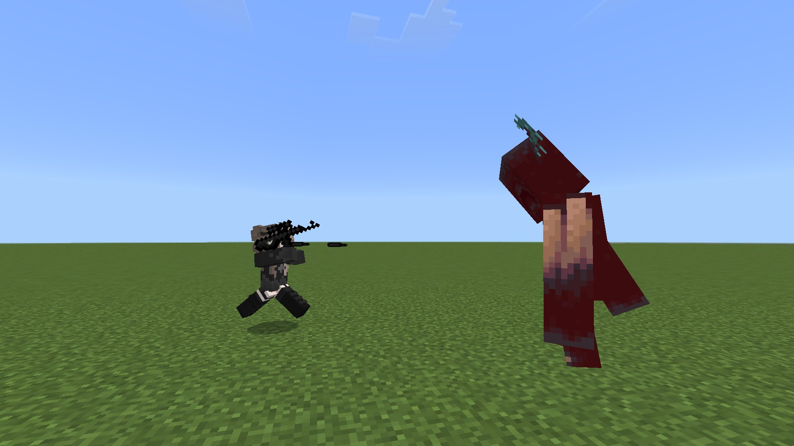

> New to the addon? You receive a loaded Fictoria Ball and a Field Manual the first time you join a world. Place the ball on the ground and you already have a companion.

---

## Getting Your First Unit

### Creative mode

- The **Equipment → Tactical_Items** group holds filled Fictoria Balls and every weapon module.
- Spawn eggs are on the normal **Items** page.
- Hold a filled ball and right-click a block — the unit appears on top of it.

### Survival mode

Craft a **Card (Card_1)**: three emeralds placed diagonally in a crafting table, then hold it and right-click to tame.

To carry her around like a Pokémon, craft an **empty Fictoria Ball**: eight emeralds in a ring with one card in the middle.

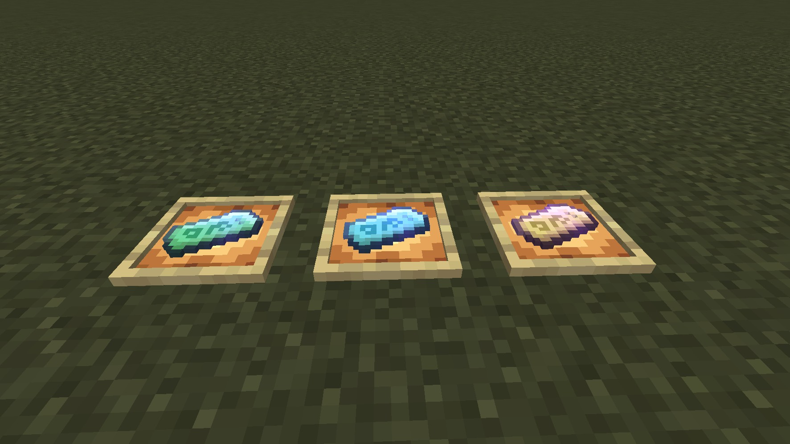

---

## Operator Tiers

Every unit is carried by a ball, and the ball sets the **recall cooldown** — how long you must wait before that unit can be deployed again.

| Ball | Recall cooldown | Who it carries |
|---|---|---|
| Gold | 25 s | Elite units with complex mechanics |
| Blue | 15 s | Elite specialists, very strong in one specific job |
| Green | 5 s | Rank-and-file units — maids, logistics, baseline combat |

The trade-off is the point: elites hit harder but cost tempo to move, while green-ball units are cheap enough to pull out and redeploy constantly. A gold unit committed to the wrong lane is a real loss; a maid is not.

---

## Combat

Most allied units have skills — some have several completely different sets. They range from large area attacks and demolition charges to teleport-and-slash strikes and even lightning summons.

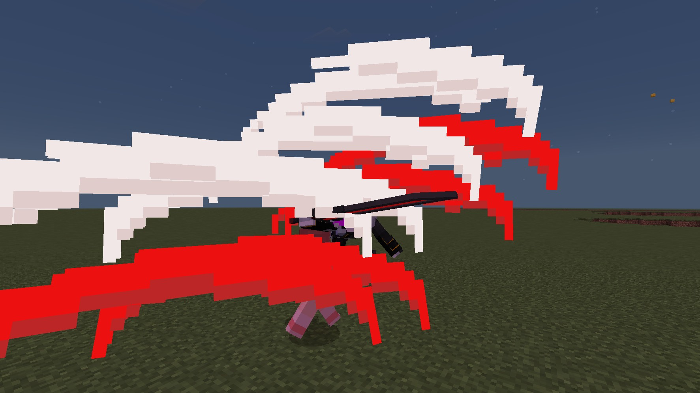
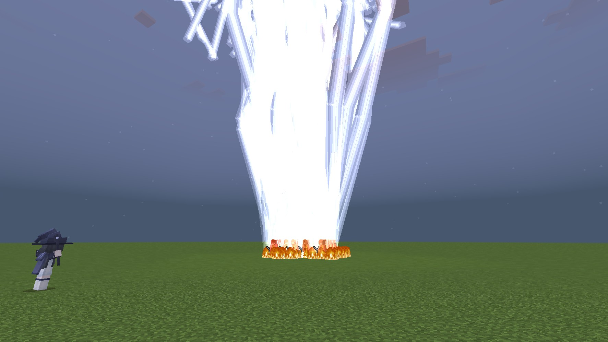

Take **DM0** as an example. She is a versatile operator who fights well at range and in melee. After landing 5 basic attacks (of either type) she gains a 5-hit follow-up combo of the same type with massively boosted damage, then returns to her basic attacks and the cycle repeats. Her ultimate immediately picks the nearest enemy in range and performs a point-blank slashing assault for 10 seconds, during which she is completely invincible.

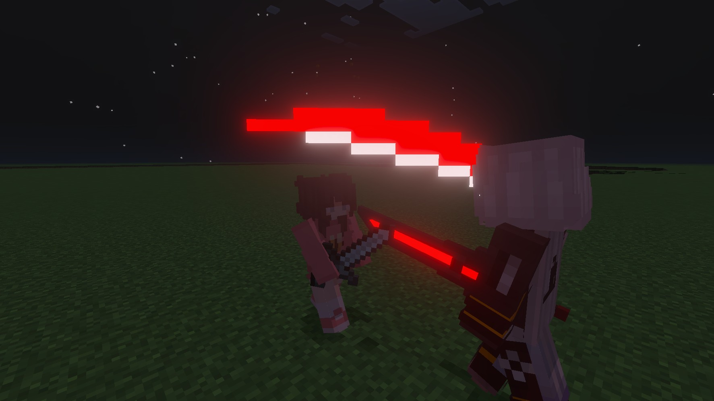
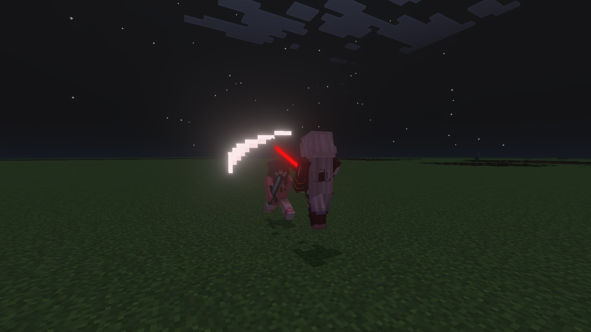
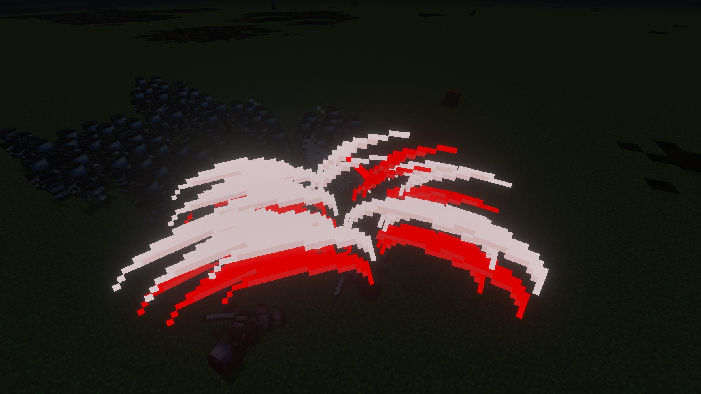

The Demon faction is just as dangerous. Many of their attacks deal large-scale explosive damage and will flatten builds in seconds. **Do not use this addon on a world you have not backed up.**

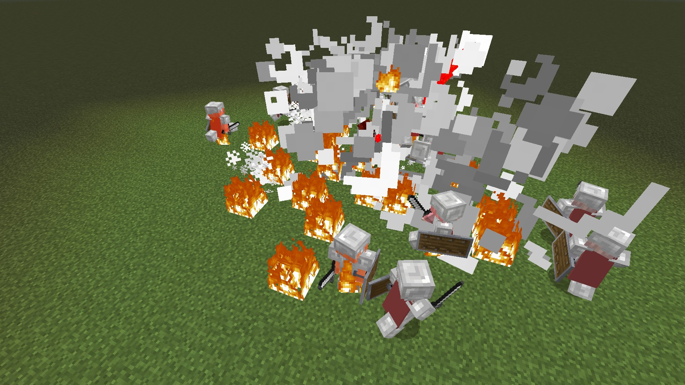

---

## The Standard Maid

Right after taming she is a **Standard Maid**. She handles combat, cooking, farming, gathering, and guarding — and she is the unit this guide focuses on.

### Combat

Hold any **sword**, **spear**, **bow**, or **crossbow** and right-click her. She equips the matching weapon and enters combat.

- Spears are used as melee thrusts — she cannot throw them.
- Her previous weapon drops at her feet when she swaps. Pick it up, or it stays there.

### Cooking

- Right-click with **raw food** → she enters cooking mode and cooks continuously.
- **Sneak + right-click** → take the finished food.
- She also cooks on her own: while idle and empty-handed, any raw food in her inventory gets cooked automatically.

### Bread

Right-click her with **bread** in any state — sitting, fighting, or gathering. She eats it and, for 10 seconds, gains **Strength II**, **Health Boost VI**, and **Absorption VI**, plus one instant heal.

Feeding her before a fight is effectively an extra shield and an extra health bar.

### Farming

- Right-click with an **iron hoe** → farming mode. She finds nearby farmland on her own.
- She plants and harvests vanilla crops, including whole-block crops such as pumpkins and melons.
- She can use bone meal, and she produces her own bone meal over time.
- If she stands on a **hopper**, her inventory empties into it automatically.

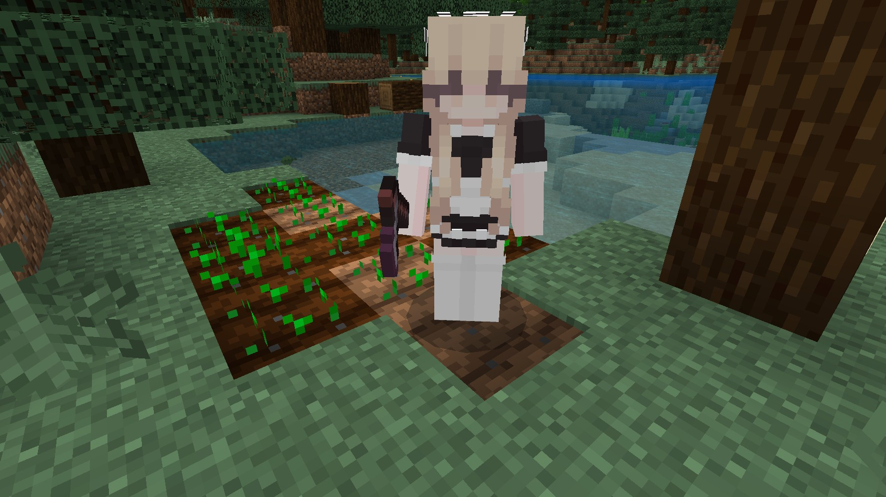

### Gathering

- Right-click with a **pickaxe** → mining. Right-click with an **axe** → tree felling.
- She finds nearby ore or logs, walks over, and starts working. Everything she breaks goes into her inventory; overflow drops at her feet.
- **Right-click (no sneak)** while she is working → open her backpack.
- **Sneak + right-click** → she stops, leaves gathering mode, and returns the tool.
- Felling a tree takes down the whole connected trunk, following it upward and sideways. It never digs downward, so it will not eat your floors or foundations.
- She routes around lava and deep pits. If a target is genuinely unreachable she waits rather than digging a tunnel.

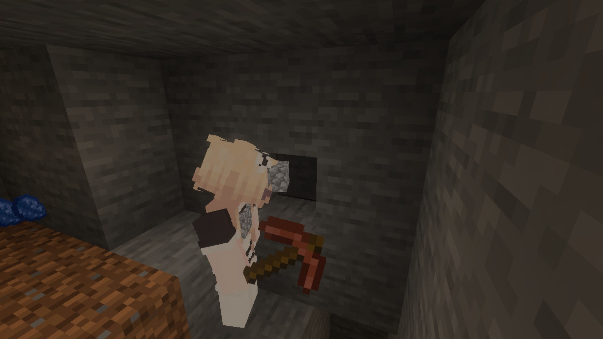
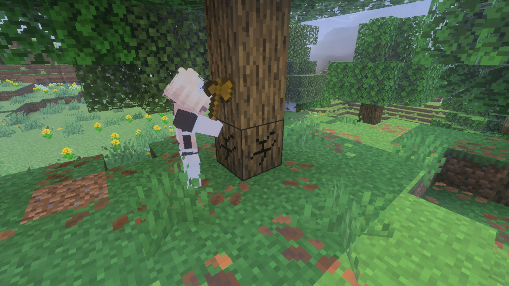

### Armor and shields

- While she is **idle and empty-handed**, right-click with armor to have her wear it.
- A shield can be equipped the same way, but she cannot take one with an empty hand — hold the shield when you right-click.
- To remove her gear: **sneak + hold Maid Command + right-click**. Her armor and shield are handed back to you.

### Opening her backpack

- Idle and empty-handed: **sneak + right-click**.
- While she is holding something: plain **right-click**.

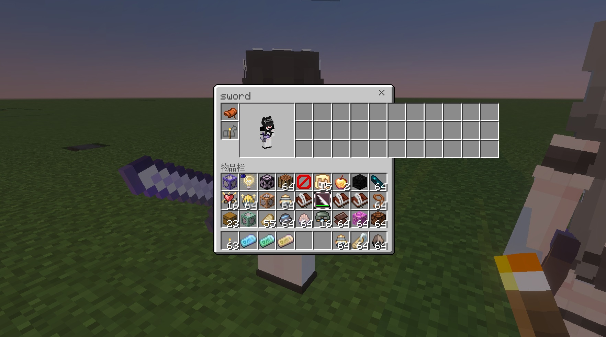

---

## The Armory Maid

The Armory Maid is the combat-specialized form of the same unit. She has far higher stats and a firearm for every range bracket.

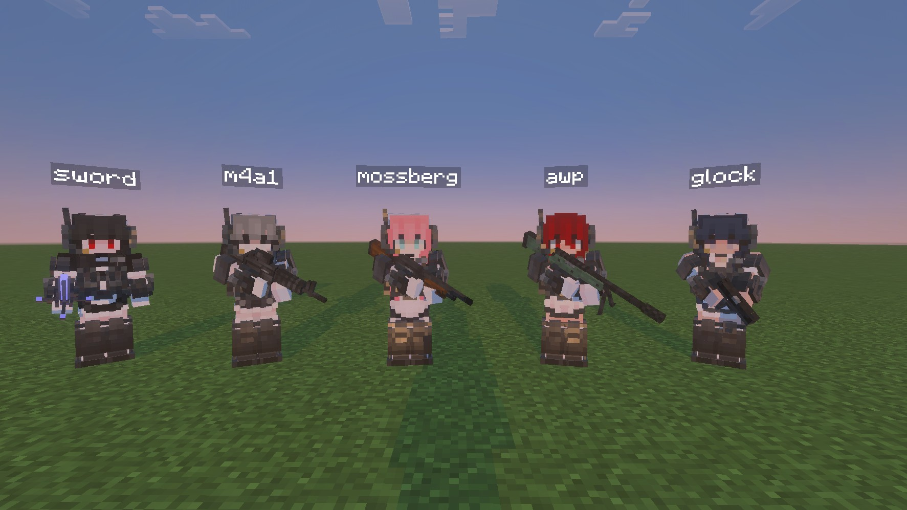

### Promotion

While she is **idle and empty-handed**, right-click with **War Cross** to promote her.

### Weapon modules

Hold a module and right-click to swap her weapon:

| Module | Weapon | Role |
|---|---|---|
| Module-M4A1 | M4A1 rifle | High rate of fire |
| Module-GLOCK | Glock pistol | Reveals hidden enemies |
| Module-MOSSBERG | Mossberg shotgun | Close-range crowd clearing |
| Module-AWP | AWP sniper rifle | Very long range |
| Module-SWORD | Photon beam sword | Close-range crowd clearing |

The old weapon drops at her feet when she swaps.

### Restrictions

The Armory Maid **cannot** wear armor, and she does not accept vanilla weapons, raw food, or hoes — she only recognizes gun modules. If you want her to cook, farm, or wear armor, demote her first.

### Demotion

While idle and empty-handed, right-click with **Gentle Cross**. She returns to Standard Maid form.

Her worn equipment and the contents of her backpack drop at her feet — collect them before you walk away.

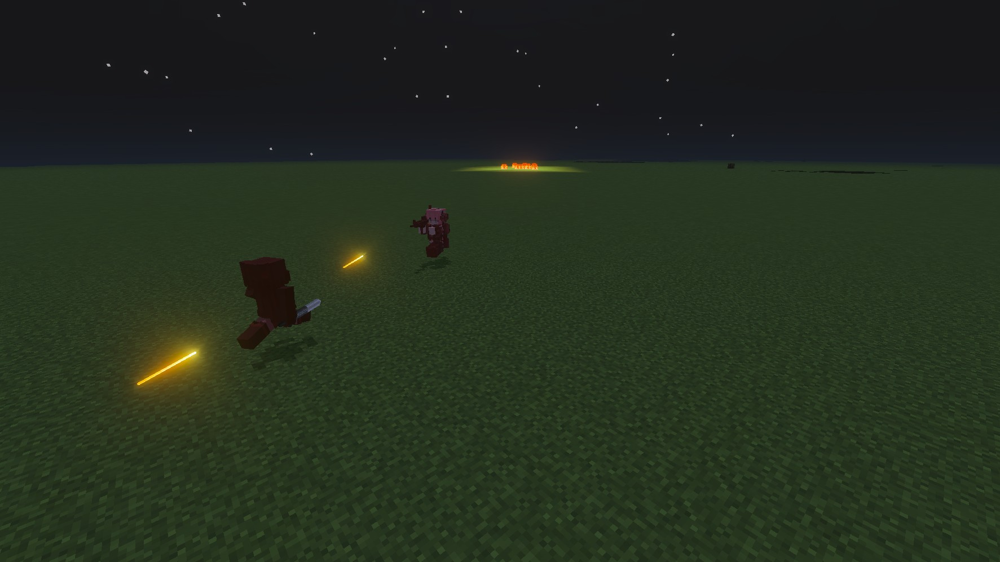

---

## Companion Features

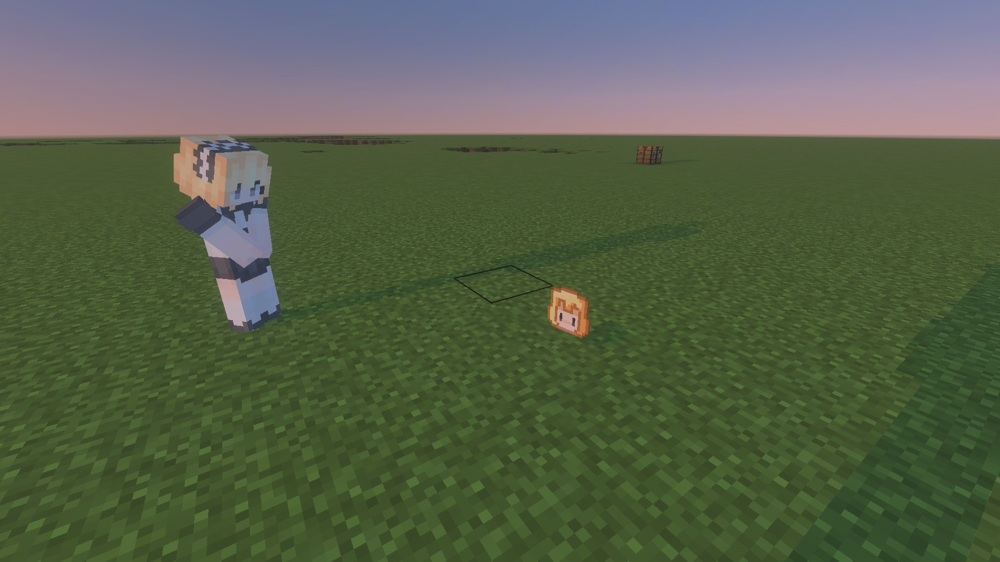

### Maid Command

You receive one when you tame her. **Holding it, or placing it in her inventory, makes her follow you.**

### Light

Put a **torch** in any slot of her inventory and she emits light.

### Saddle: ride or carry

- Put a **saddle** in her saddle slot → you can ride her.
- Hold a saddle and right-click her → pick her up or put her down.

### Riding mounts

Open the command menu and turn on the **ride** toggle. She then:

- Boards a **horse, donkey, pig, or llama** within 16 blocks.
- Drives it along your path while in follow mode.
- Rescues a stuck mount: if the mount has not moved for about 1.5 seconds and there is a step or drop ahead, mount and maid are teleported to you. Being more than 40 blocks away also triggers a single teleport.

### Boats

If you are sitting in a boat, she boards it herself and rows to follow you. Wooden boats, bamboo rafts, and chest boats all work.

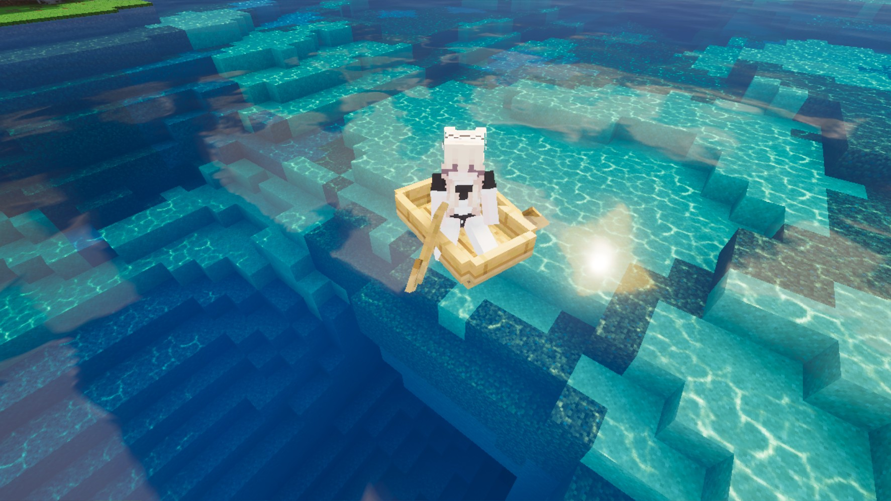

### Recall

In follow mode, if she is more than **38 blocks** from you she is teleported back.

While she is sitting in a vehicle this rule does not apply to her directly — the **vehicle** is teleported instead, so she is never yanked off her mount.

### Tactical command menu

**Sneak + left-click** her to open the menu.

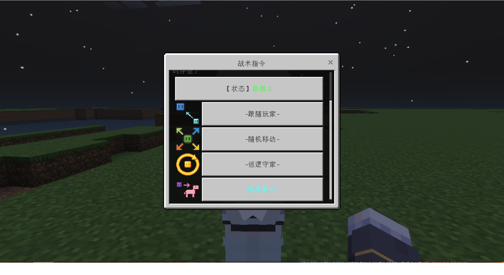

| Mode | Behavior |
|---|---|
| Follow | Follows you like a vanilla cat or dog, teleporting when too far |
| Random | Wanders freely with no restrictions |
| Patrol | Guards the block she was standing on when enabled, patrolling within a **32-block** square around it and teleporting back to the center if she leaves |
| Ride | Toggle for mount / boat following |

---

## Fictoria Ball

The ball is her portable home.

### Capture

Hold an **empty green ball** and right-click her. Her 36 inventory slots, worn equipment, name, and health state are stored with her.

### Release

Hold the **filled ball** and right-click a block — she appears on the block surface. The cooldown started the moment you captured her, and it gates the release: **5 seconds** for the green ball, 15 for blue, 25 for gold. While it runs, the ball shows as a CD item.

> A maid who was wearing armor or a shield will have that gear moved into her backpack when she is released from a ball.

### Owner protection

The ball records its owner. Anyone who is not the owner **cannot release** the unit inside.

A freshly crafted ball has no owner recorded — whoever releases it becomes her owner.

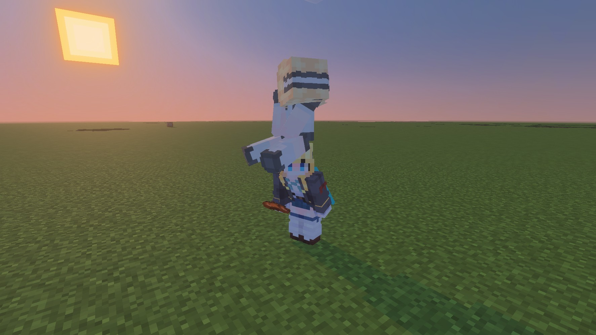

---

## Crafting Reference

Don't mix these up — the maid uses a lot of similar-looking items.

| Item | Recipe |
|---|---|
| Card (Card_1) | Emerald ×3 |
| Fictoria Ball (empty) | Emerald ×8 + Card ×1 (≈ 11 emeralds) |
| Maid Spawn Egg | Gold Ingot ×4 + Redstone ×1 + Emerald ×1 |
| War Cross | Diamond ×1 + Gold Ingot ×4 + Emerald ×2 |
| Gentle Cross | Redstone ×1 + Stick ×4 + Gold Nugget ×2 |
| Module-M4A1 | Redstone Block ×1 + Blaze Rod ×1 + Amethyst ×2 + Obsidian ×2 |
| Module-GLOCK | Stick ×1 + Redstone ×1 + Stone ×1 + Iron Ingot ×1 |
| Module-MOSSBERG | Redstone Block ×1 + Blaze Rod ×1 + TNT ×2 + Obsidian ×3 |
| Module-AWP | Blaze Rod ×1 + Amethyst ×2 + Obsidian ×1 + Spyglass ×1 + Block of Iron ×1 + Redstone Block ×1 |
| Module-SWORD | Diamond Sword ×1 |

---

## Troubleshooting

| Symptom | Reason |
|---|---|
| She won't take armor | She is holding something, is in a working state, or is in Armory Maid form |
| Right-click opens the wrong thing | The first matching rule wins: armor → shield → food → hoe → weapon → Maid Command → saddle → cooking → leave-state |
| Her old weapon vanished | It dropped at her feet on the swap |
| She won't follow | No Maid Command in her inventory, or she is in a gathering state (gathering deliberately does not follow) |
| She stopped gathering | She reached an unreachable target, her tool changed, or the state was exited — sneak + right-click restarts it |
| I can't release my unit | You are not the ball's owner |
